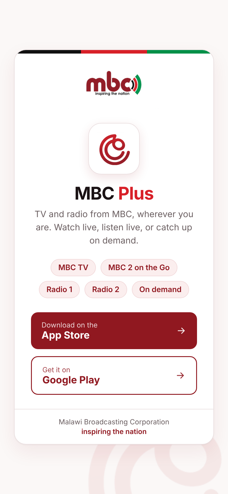

# MBC Plus — download link & QR code

One link and one QR code that send people to the **MBC Plus** app in the right store.

**Live:** https://mbc.mw/plus

| Visitor | What happens |
|---|---|
| iPhone / iPad | Redirects to the [App Store](https://apps.apple.com/app/id6746721895) (id `6746721895`) |
| Android | Redirects to [Google Play](https://play.google.com/store/apps/details?id=com.mbc.mbcplus) (`com.mbc.mbcplus`) |
| Desktop / other | Shows a branded page with both store buttons |

<p align="center">
  
  &nbsp;&nbsp;
  
</p>

> ⚠️ **The QR code is printed on marketing material.** The page at `mbc.mw/plus` must stay online
> permanently. Do not delete or move `public_html/plus/` on the mbc.mw server, and keep it in place
> during any WordPress migration or clean-up. If a store link ever changes, edit the page — never the QR.

## Repository layout

```
site/plus/     The page deployed to the server (index.html + images)
qr/            QR codes — SVG/PDF for print, PNG for screens; generate.py rebuilds them
brand/         Original MBC logo files used for the page and QR
docs/          Screenshots
```

## QR codes

| File | Use |
|---|---|
| `qr/mbc-plus-qr-logo.svg` | **Print** (flyers, posters) — with MBC mark |
| `qr/mbc-plus-qr-logo.png` | Social media, slides — with MBC mark |
| `qr/mbc-plus-qr.svg` / `.pdf` / `.png` | Plain versions, no logo |

All encode `https://mbc.mw/plus` with high (H) error correction.

**Print guidelines:** at least 2.5 cm wide on flyers (≈ 1/10 of scanning distance on posters), keep the
white border clear, dark code on a light background, and test the final artwork with an iPhone and an
Android phone before printing in bulk.

Regenerate: `pip install segno pillow && python qr/generate.py`

## Deploying the page

The server is the mbc.mw cPanel account. The page lives at `/home/mbc/public_html/plus/`
(the folder takes priority over WordPress, so the main site is unaffected).

1. Edit files in `site/plus/`.
2. In cPanel → File Manager, upload the changed files into `public_html/plus/` (overwrite).
3. Open https://mbc.mw/plus on a desktop (page should show) and scan the QR with a phone (should open the store).

## Brand

Colours used: maroon `#901820`, red `#d82028`, green `#009048`, black `#111`.
